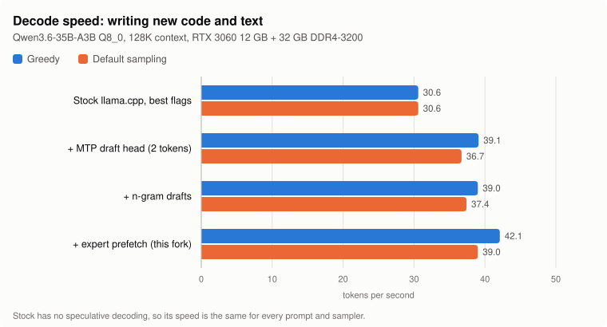
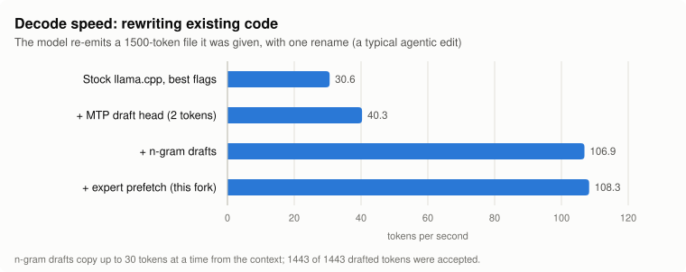
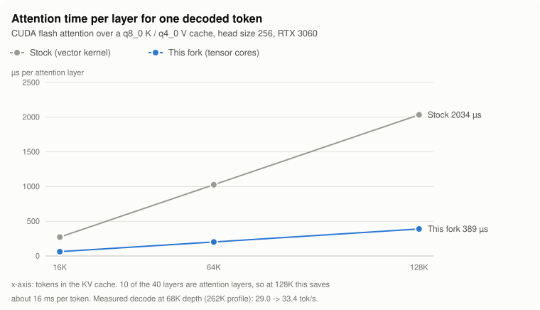
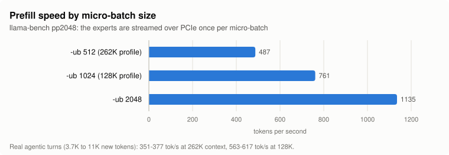
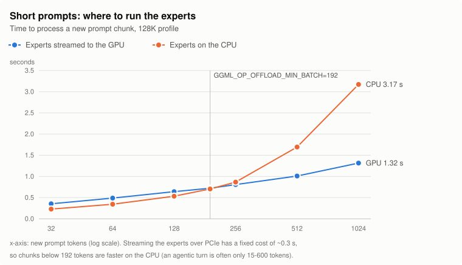

# This fork: Qwen3.6-35B-A3B Q8_0 on a 12 GB GPU

This fork runs **Qwen3.6-35B-A3B at Q8_0** (35.8 GiB of weights, plus its built-in MTP draft head) with a **128K or full
262K context** on an ordinary desktop, as the backend of an agentic coding harness:

- AMD Ryzen 9 5950X (16 cores / 32 threads)
- 32 GB DDR4-3200 (about 45 GB/s of read bandwidth)
- NVIDIA RTX 3060 12 GB on PCIe 4.0
- NVMe SSD

The model does not fit in VRAM + RAM with room to spare, so every byte and every millisecond is placed deliberately.
The changes are specific to this model (the `qwen35moe` architecture) and this kind of machine. Everything else is
upstream llama.cpp; its README follows [further below](#llamacpp).

| | Stock llama.cpp, best flags | This fork |
|---|---|---|
| Decode, writing new code (greedy) | 30.6 tok/s | **42.1 tok/s** (+38%) |
| Decode, writing new code (default sampling) | 30.6 tok/s | **39.0 tok/s** (+27%) |
| Decode, rewriting existing code | 30.6 tok/s | **108.3 tok/s** (3.5x) |
| Attention per layer and token at 128K context | 2034 us | **389 us** (5.2x) |
| Prefill, llama-bench pp2048 | 487 tok/s (`-ub 512`) | **761 tok/s** (`-ub 1024`) |
| Prefill, 64-token agentic turn | 0.49 s | **0.34 s** |
| Context | 128K | **128K** (default profile) or **262,144** |
| VRAM used | ~11.0 of 12 GB | 11.2-11.3 of 12 GB |

"Stock, best flags" is upstream llama.cpp with the best settings found for this machine (`-ncmoe 33 -fa on -ctk q8_0
-ctv q8_0 -lm dio -t 16`, 128K context) and no speculative decoding. Decode numbers are measured through `llama-server`
at 128K context; they vary by about 1-2 tok/s between runs.

## Benchmarks

### Decode

Writing new text is limited by how fast the CPU can read the routed experts from RAM. The MTP draft head (shipped in
the GGUF) proposes 2 tokens per step and the main model verifies them in one batch; expert prefetch then hides part
of the remaining memory traffic behind GPU work.

<picture>
  <source media="(prefers-color-scheme: dark)" srcset="docs/qwen36/decode-new-code-dark.svg">
  
</picture>

Agentic coding re-emits a lot of existing code (edits, rewrites, quoting). n-gram drafts find the continuation in
the context and propose up to 30 tokens at once, which the GPU verifies nearly for free.

<picture>
  <source media="(prefers-color-scheme: dark)" srcset="docs/qwen36/decode-rewrite-dark.svg">
  
</picture>

### Attention at long context

Stock llama.cpp runs single-token attention over a quantized KV cache on CUDA cores. This fork runs it on the tensor
cores, which keeps decode fast deep into the context.

<picture>
  <source media="(prefers-color-scheme: dark)" srcset="docs/qwen36/fa-kernel-dark.svg">
  
</picture>

| KV cache depth | Stock, 1 token | Fork, 1 token | Stock, 3 tokens (MTP verify) | Fork, 3 tokens |
|---|---|---|---|---|
| 16K | 273 us | 63 us | 332 us | 90 us |
| 64K | 1027 us | 202 us | 1267 us | 308 us |
| 128K | 2034 us | 389 us | 2325 us | 600 us |

### Prefill

With 33 of 40 layers' experts in system RAM, a large prompt is processed by streaming those experts over PCIe to
the GPU, once per micro-batch. Bigger micro-batches amortize the transfer, so the 128K profile spends VRAM on
`-ub 1024`.

<picture>
  <source media="(prefers-color-scheme: dark)" srcset="docs/qwen36/prefill-ubatch-dark.svg">
  
</picture>

Streaming the experts has a fixed cost of about 0.3 s, which dominates the short turns that make up most of an
agentic session (a tool result of a few dozen to a few hundred tokens). Below 192 tokens the experts are run on the
CPU instead:

<picture>
  <source media="(prefers-color-scheme: dark)" srcset="docs/qwen36/prompt-offload-dark.svg">
  
</picture>

Agentic multi-turn test (`scripts/qwen36/bench_multiturn.py`: two large tool outputs, then a short question):

| Profile | Turn 1 (11.2K new tokens) | Turn 2 (3.7K new tokens) | Turn 3 |
|---|---|---|---|
| 128K, `-ub 1024` | 617 tok/s | 563 tok/s | ~25 new tokens, rest from cache |
| 262K, `-ub 512` | 377 tok/s | 351 tok/s | ~25 new tokens, rest from cache |

## What this fork does differently

### Where everything lives

| Tier | Contents |
|---|---|
| VRAM (12 GB, ~11.3 GB used) | all non-expert weights of the 40 layers (attention, Gated DeltaNet, shared experts, routers), the routed experts of the last 7 layers, the MTP head, KV cache and recurrent state, compute buffers |
| RAM (32 GB) | the routed experts of the first 33 layers (~28 GiB), read once at startup with direct I/O and kept resident |
| SSD | the token embedding table (0.5 GB), read on demand |

Per decoded token, the CPU reads 8 of 256 experts in each of 33 layers (about 0.9 GB), which makes DDR4 bandwidth the
limit. A decode step with MTP (about 66 ms for 2-3 tokens) spends ~46 ms in the CPU experts, ~16 ms on the GPU,
~4.6 ms drafting and ~1.3 ms in copies.

### Code changes

1. **Expert prefetch** (`src/llama-moe-prefetch.{h,cpp}`, hooks in `src/llama-graph.{h,cpp}`,
   `src/models/qwen35moe.cpp`). While the GPU computes the attention of layer L+1, the CPU cores would sit idle. The
   fork predicts which experts layer L+1 will route to, by applying layer L+1's router (folded with the ratio of the
   two layers' norm weights, kept as a Q8_0 copy in RAM) to layer L's expert input. On average 84% of the 8 predicted
   experts are among the ones actually chosen. Helper threads pinned on the SMT siblings of the compute threads then load exactly the
   rows each compute thread will multiply, and stop as soon as the real routing is known. The output is bit-identical
   with prefetch on and off (KL divergence 0). Single-token decode goes from 30.6 to 34.4 tok/s (+12%); with
   speculative decoding the gain is +8% greedy, +4% sampled and +1% when rewriting code.
2. **Tensor-core flash attention for a quantized KV cache** (`ggml/src/ggml-cuda/fattn-mma-f16.cuh`,
   `ggml/src/ggml-cuda/fattn.cu`, two new template instances). The MMA kernel can now read q8_0 K and q8_0/q4_0 V
   directly, dequantizing each tile to f16 as it loads it into shared memory. Stock llama.cpp either uses the slower
   vector kernel or first converts the whole cache to f16 in a scratch buffer. Enabled for Turing and newer, head size
   256 and a GQA ratio that is a multiple of 8 (Qwen3.6 has 16 query heads and 2 KV heads). Perplexity is unchanged
   and the `test-backend-ops` flash attention suite passes.
3. **Sliding-window KV for the MTP draft head** (`src/llama-model.cpp`, `LLAMA_MTP_SWA=<tokens>`). The draft head has
   its own KV cache, which at 128K-262K context costs VRAM that is better spent on the main model. The 16K window only
   affects the drafts, never the output, because the main model verifies every drafted token.
4. **Lazy token embedding** (`src/models/qwen35moe.cpp`). With `--lazy-mode on` the 0.5 GB embedding table stays on
   the SSD and only the rows of tokens that occur are read, leaving that RAM for experts.
5. **Static work split in the CPU `mul_mat_id` for batches of up to 4 tokens** (`ggml/src/ggml-cpu/ggml-cpu.c`). Each
   thread always processes the same rows of an expert, so the rows a prefetch helper loaded are used by the core next
   to it. This alone is ~4% faster for the 3-token batches of MTP verification.

### Configuration (upstream features, tuned for this machine)

- **`-ncmoe 33`**: keep the routed experts of 33 of the 40 layers in RAM; everything else fills the GPU to ~94%.
- **`-lm dio`** instead of mmap: with mmap, at 128K context the mapped weights no longer fit next to everything else
  and decode collapses to 4.5 tok/s from disk thrashing. Direct I/O also cuts tensor loading from 146 s to 20 s
  (about 34 s from start to ready).
- **Speculative decoding, two drafters at once**: the MTP head with 2 draft tokens for new text (1 token: 36.3, 2:
  38.7, 3: 36.3 tok/s greedy) and `ngram-mod` (match 24 tokens, draft 4-30) for text that repeats the context.
- **`GGML_OP_OFFLOAD_MIN_BATCH=192`**: run the experts of short prompts on the CPU, see the chart above.
- **Thread pinning**: 16 compute threads on the physical cores 0-15 (`-C 0xFFFF --cpu-strict 1`), the prefetch
  helpers on their SMT siblings 16-31.
- **Quantized KV cache** (`-ctk q8_0 -ctv q8_0`, or `-ctv q4_0` for 262K), `--cache-ram 0` (RAM is the scarcest
  resource) and `--ctx-checkpoints 4`, so follow-up turns reuse the cache.

Tried and dropped: confidence-gated MTP drafting (higher acceptance, but fewer tokens per second) and longer MTP
drafts (3 to 6 tokens).

## Running it

```sh
cmake -B build -DGGML_CUDA=ON -DCMAKE_CUDA_ARCHITECTURES=86 \
    -DGGML_CUDA_FA_QUANTS="q4_0-q4_0;q8_0-q8_0;f16-f16;bf16-bf16;q8_0-q4_0"
cmake --build build -j --target llama-server

# put Qwen3.6-35B-A3B-Q8_0-MTP.gguf (unsloth) into models/, then:
LLAMA_API_KEY=... scripts/qwen36/start-server.sh

# reproduce the decode and prefill numbers against the running server
scripts/qwen36/bench.sh
```

`scripts/qwen36/start-server.sh` is the 128K profile. For the full 262K context use
`-c 262144 -ub 512 -ncmoe 34 -ctv q4_0`. The charts are generated by `scripts/qwen36/make_charts.py`.

| Environment variable | Meaning |
|---|---|
| `LLAMA_MOE_PREFETCH=<n>` | prefetch the `n` most likely experts of the next layer (off by default; 8 recommended) |
| `LLAMA_MOE_PREFETCH_CPUS=<a-b>` | CPUs for the prefetch helper threads (the SMT siblings of the compute threads) |
| `LLAMA_MOE_PREFETCH_US=<us>` | upper bound for one prefetch, default 1000 |
| `LLAMA_MOE_PREFETCH_MAX_TOKENS=<n>` | only prefetch for batches of up to `n` tokens, default 4 |
| `LLAMA_MTP_SWA=<tokens>` | sliding window of the MTP draft head's KV cache |
| `GGML_OP_OFFLOAD_MIN_BATCH=<n>` | (upstream) smallest batch for which CPU weights are streamed to the GPU |

---

# llama.cpp


<div align="center">

<b>LLM inference in C/C++</b>

[](https://opensource.org/licenses/MIT)
[](https://github.com/ggml-org/llama.cpp/releases?q=tag:v0)
[](https://github.com/ggml-org/llama.cpp/releases?q=b)
[](https://github.com/ggml-org/llama.cpp/actions/workflows/server.yml)
[](https://github.com/ggml-org/llama.cpp/actions/workflows/docker.yml)
[](https://github.com/ggml-org/llama.cpp/actions/workflows/winget.yml)

[ggml](https://github.com/ggml-org/ggml) / [ops](https://github.com/ggml-org/llama.cpp/blob/master/docs/ops.md) / [maintainer PRs](https://github.com/ggml-org/llama.cpp/issues?q=is%3Apr%20is%3Aopen%20draft%3AFalse%20(author%3Argerganov%20OR%20author%3AKitaitiMakoto%20OR%20author%3Adanbev%20OR%20author%3Aaldehir%20OR%20author%3Amax-krasnyansky%20OR%20author%3ACISC%20OR%20author%3Aggerganov%20OR%20author%3Aam17an%20OR%20author%3Ajhen0409%20OR%20author%3Abartowski1182%20OR%20author%3Anikwen%20OR%20author%3Ahipudding%20OR%20author%3Aravi9%20OR%20author%3AServeurpersoCom%20OR%20author%3Apwilkin%20OR%20author%3Areeselevine%20OR%20author%3Angxson%20OR%20author%3Ajeffbolznv%20OR%20author%3Amarty1885%20OR%20author%3A0cc4m%20OR%20author%3ATitaniumtown%20OR%20author%3Aangt%20OR%20author%3AIMbackK%20OR%20author%3Aarthw%20OR%20author%3AJohannesGaessler%20OR%20author%3AORippler%20OR%20author%3Aruixiang63%20OR%20author%3Axctan%20OR%20author%3Aallozaur%20OR%20author%3Ayomaytk%20OR%20author%3Aaendk%20OR%20author%3Awine99%20OR%20author%3Agaugarg-nv%20OR%20author%3Ataronaeo%20OR%20author%3Aforforever73%20OR%20author%3Alhez%20OR%20author%3Anetrunnereve%20OR%20author%3Afairydreaming)%20sort%3Aupdated-desc) / [dev stats](https://github.com/ggml-org/llama.cpp-dev) / [lib llama API](https://github.com/ggml-org/llama.cpp/issues/9289) / [llama-server REST API](https://github.com/ggml-org/llama.cpp/issues/9291)

</div>

## Quick start

A few options to get `llama.cpp` installed on your machine:

```bash
# curl
curl -LsSf https://llama.app/install.sh | sh

# powershell
irm https://llama.app/install.ps1 | iex
```

- Visit https://llama.app and follow the instructions
- Run with Docker - see our [Docker documentation](docs/docker.md)
- Download pre-built binaries from the [releases page](https://github.com/ggml-org/llama.cpp/releases)
- Build from source by cloning this repository - check out [our build guide](docs/build.md)

Once installed:

```sh
# Download and run a model directly from Hugging Face
llama cli -hf ggml-org/Qwen3.5-0.8B-GGUF

# Launch OpenAI-compatible API server
llama serve -hf ggml-org/Qwen3.5-0.8B-GGUF
```

<table align="center">
    <tr>
        <td align="center" width=50%>
            
            <i>VLM session with <b>llama cli</b></i>
        </td>
        <td align="center">
            
            <i>Built-in web UI against <b>llama serve</b></i>
        </td>
    </tr>
<table>

## Description

The main goal of `llama.cpp` is to enable LLM (and VLM) inference with minimal setup and state-of-the-art performance on
a wide range of hardware - locally and in the cloud.

- Plain C/C++ implementation without any dependencies
- Apple silicon is a first-class citizen - optimized via ARM NEON, Accelerate and Metal frameworks
- AVX, AVX2, AVX512 and AMX support for x86 architectures
- RVV, ZVFH, ZFH, ZICBOP and ZIHINTPAUSE support for RISC-V architectures
- 1.5-bit, 2-bit, 3-bit, 4-bit, 5-bit, 6-bit, and 8-bit integer quantization for faster inference and reduced memory use
- Custom CUDA kernels for running LLMs on NVIDIA GPUs (support for AMD GPUs via HIP and Moore Threads GPUs via MUSA)
- Vulkan and SYCL backend support
- CPU+GPU hybrid inference to partially accelerate models larger than the total VRAM capacity

The `llama.cpp` project is build on top of the [ggml](https://github.com/ggml-org/ggml) library.

## Supported backends

| Backend | Target devices |
| --- | --- |
| [BLAS](docs/build.md#blas-build) | All |
| [BLIS](docs/backend/BLIS.md) | All |
| [CANN](docs/build.md#cann) | Ascend NPU |
| [CUDA](docs/build.md#cuda) | Nvidia GPU |
| [HIP](docs/build.md#hip) | AMD GPU |
| [Hexagon](docs/backend/snapdragon/README.md) | Snapdragon |
| [IBM zDNN](docs/backend/zDNN.md) | IBM Z & LinuxONE |
| [MUSA](docs/build.md#musa) | Moore Threads GPU |
| [Metal](docs/build.md#metal-build) | Apple Silicon |
| [OpenCL](docs/backend/OPENCL.md) | Adreno GPU |
| [OpenVINO [In Progress]](docs/backend/OPENVINO.md) | Intel CPUs, GPUs, and NPUs |
| [RPC](https://github.com/ggml-org/llama.cpp/tree/master/tools/rpc) | All |
| [SYCL](docs/backend/SYCL.md) | Intel GPU |
| [VirtGPU](docs/backend/VirtGPU.md) | VirtGPU APIR |
| [Vulkan](docs/build.md#vulkan) | GPU |
| [WebGPU](docs/build.md#webgpu) | All |
| [ZenDNN](docs/build.md#zendnn) | AMD CPU |

## Documentation

#### Tools

- [cli](tools/cli/README.md)
- [completion](tools/completion/README.md)
- [server](tools/server/README.md)
- [GBNF grammars](grammars/README.md)

#### Development

- [How to build](docs/build.md)
- [Running on Docker](docs/docker.md)
- [Build on Android](docs/android.md)
- [Multi-GPU usage](docs/multi-gpu.md)
- [Performance troubleshooting](docs/development/token_generation_performance_tips.md)
- [GGML tips & tricks](https://github.com/ggml-org/llama.cpp/wiki/GGML-Tips-&-Tricks)
- [XCFramework](docs/xcframework.md)
- [Completions](docs/completions.md)
- [Models](docs/models.md)
- [Release process](docs/release.md)

## Contributing

- Contributors can open PRs
- Collaborators will be invited based on contributions
- Maintainers can push to branches in the `llama.cpp` repo and merge PRs into the `master` branch
- Any help with managing issues, PRs and projects is very appreciated!
- Read the [CONTRIBUTING.md](CONTRIBUTING.md) for more information

## Acknowledgements

- [yhirose/cpp-httplib](https://github.com/yhirose/cpp-httplib) - Single-header HTTP server, used by `llama-server` - MIT license
- [nothings/stb](https://github.com/nothings/stb) - Single-header image format decoder, used by multimodal subsystem - Public domain
- [nlohmann/json](https://github.com/nlohmann/json) - Single-header JSON library, used by various tools/examples - MIT License
- [mackron/miniaudio](https://github.com/mackron/miniaudio) - Single-header audio format decoder, used by multimodal subsystem - Public domain
- [sheredom/subprocess.h](https://github.com/sheredom/subprocess.h) - Single-header process launching solution for C and C++ - Public domain
