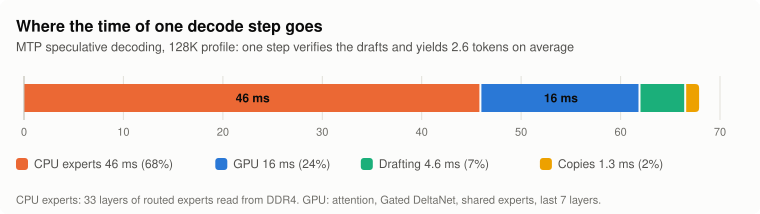
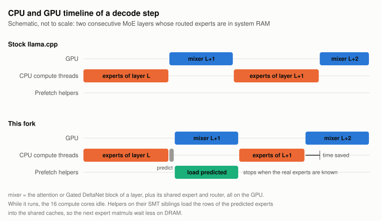

# Bytes, Not FLOPs: Fast Single-Stream Inference of a 35B Mixture-of-Experts Model on a 12 GB GPU

**horrified-dev and Claude Opus 5.5 (Anthropic)**

October 2026

Code: this repository (`src/llama-moe-prefetch.*`, `ggml/src/ggml-cuda/fattn*`, `src/models/qwen35moe.cpp`).
Scripts and raw benchmark harness: `scripts/qwen36/`.

---

## Abstract

We run Qwen3.6-35B-A3B, a 35-billion-parameter mixture-of-experts (MoE) language model with 3 billion active
parameters, at 8-bit precision (Q8_0, 35.8 GiB) on a desktop with a 12 GB RTX 3060, 32 GB of DDR4-3200 and a 16-core
Ryzen 9 5950X, with a context of 128K or the full 262,144 tokens. The weights exceed the GPU memory three times over,
so most of the model is executed by the CPU out of system RAM, and single-stream decoding is bound by DRAM bandwidth.
Our thesis is that on such a machine every optimization worth making either *moves fewer bytes per token*, *makes
each moved byte serve more tokens*, or *moves bytes while a link would otherwise sit idle*. Following it, we combine
(i) a placement of every tensor in the memory tier where it is read least expensively, (ii) two speculative decoders,
the model's own multi-token-prediction (MTP) head and an n-gram matcher, (iii) a new *expert prefetcher* that
predicts the next layer's experts on the CPU and loads them on idle SMT siblings while the GPU computes, which is
bit-exact by construction, and (iv) a tensor-core flash-attention kernel that reads a quantized KV cache once per
grouped-query group. Against the best configuration of stock llama.cpp, decoding speed rises from 30.6 to 42.1 tokens/s
for new text (greedy) and to 108.3 tokens/s when the model rewrites existing code; attention at 128K context becomes
5.2x faster. We report what worked, what did not, and one scheduling pitfall that silently changes numerics.

---

## 1. Introduction

Open-weight MoE models make large parameter counts cheap to *compute*: Qwen3.6-35B-A3B activates only 8 of 256 experts
per layer, about 3B parameters per token. They do not make them cheap to *store*. At Q8_0 the model is 35.8 GiB, while
the target machine has 12 GB of VRAM and 32 GB of RAM, part of which the operating system needs. The usual consumer
answer is a lower-bit quantization; we instead keep Q8_0 and ask how fast a single conversation can be served, as the
backend of an agentic coding tool.

The workload matters. An agentic coding session is one long conversation (we target 128K tokens and up) in which each
turn appends a tool result of a few dozen to a few thousand tokens and the model answers with a few hundred tokens,
often re-emitting code it has already seen. Generation latency therefore dominates, prompt processing is mostly
incremental, and a large part of the output is copied from the context.

### 1.1 Thesis

With the weights spread over GDDR6, DDR4 and an SSD, connected by PCIe, the speed of single-stream decoding is set by
how many bytes must be read through the slowest path per generated token, not by arithmetic. We therefore evaluate
every candidate change by its effect on bytes:

1. **Place** each byte in the tier where it costs least per token (Section 3).
2. **Amortize**: make each byte that is read serve more than one token (speculative decoding, Section 4).
3. **Overlap**: read bytes while a link or a core would otherwise idle (expert prefetch, Section 5).
4. **Read once**: never read the same byte twice in one operation (grouped attention over a quantized cache,
   Section 6).

### 1.2 Contributions

- An analysis of where time goes when a 35B MoE runs mostly on a desktop CPU with a small GPU, and a placement that
  fits 128K-262K tokens of context with more than 80% of VRAM in use.
- **Bit-exact expert prefetch.** The router of layer $`\ell+1`$, rescaled by the ratio of the two layers' norm
  weights, is applied to the expert input of layer $`\ell`$ on the CPU; helper threads pinned to the SMT siblings of
  the compute threads demand-load exactly the weight rows each compute thread will read, until the real routing is
  known. Single-token decoding becomes 12% faster with identical outputs.
- **Tensor-core flash attention over a quantized KV cache** for head size 256 and grouped-query attention (GQA)
  ratios that are multiples of 8, dequantizing tiles on load instead of converting the cache. 5.2x faster per layer
  at 128K, at 78% of the GPU's DRAM bandwidth.
- A combination of MTP and n-gram drafting, a sliding-window KV cache for the MTP draft head, an empirically chosen
  CPU/GPU threshold for prompt chunks, and an end-to-end evaluation on the target workload.

---

## 2. Background

### 2.1 The model

Qwen3.6-35B-A3B (architecture `qwen35moe` in llama.cpp) has 40 decoder layers with hidden size 2048. Three of every
four layers use a Gated DeltaNet linear-attention mixer with a fixed-size recurrent state; every fourth layer (10 in
total) uses full softmax attention with 16 query heads and 2 key/value heads of dimension 256, a GQA ratio of 8. Every
layer ends in an MoE block with 256 routed experts, of which the router selects 8 per token, plus a shared expert. Each
routed expert is a gated FFN with an intermediate size of 512, i.e. three 2048x512 matrices: 3.15M parameters, or
3.34 MB at Q8_0. The checkpoint we use also contains a 41st block, an MTP head that predicts the token after next from
the last hidden state and the embedding of the next token, which llama.cpp can use as a built-in draft model. The
vocabulary has 248,320 tokens.

| Component | Q8_0 size |
|---|---|
| Routed experts, one layer (256 x 3.34 MB) | 855 MB |
| Routed experts, all 40 layers | 34.2 GB |
| Token embedding (248,320 x 2048) | 0.54 GB |
| Everything else (mixers, shared experts, routers, norms, output head, MTP head) | about 3.7 GB |
| **Total** | **38.4 GB (35.8 GiB)** |

### 2.2 Hybrid CPU/GPU MoE inference in llama.cpp

llama.cpp's scheduler splits the compute graph by backend. A common MoE setup keeps the routed expert tensors of the
first $`N`$ layers in host memory (`-ncmoe N`) and everything else on the GPU. For each such layer the GPU computes the
mixer, the shared expert and the router; the selected expert ids are copied to the host, the CPU computes the routed
experts with `mul_mat_id`, and the result is copied back. For large batches the scheduler instead *offloads*: it
uploads the experts the batch uses over PCIe and runs them on the GPU (`GGML_OP_OFFLOAD_MIN_BATCH` sets the smallest
batch for which this happens).

### 2.3 Speculative decoding

A draft model proposes $`k`$ tokens; the target verifies all of them in one batched forward pass and keeps the longest
prefix that matches its own choices [1, 2]. Output is unchanged. For a dense model on a GPU, verifying $`k+1`$ tokens
costs about as much as generating one. For an MoE on a CPU it does not: each extra token may route to experts that no
other token in the batch uses, and every distinct expert must be read from DRAM.

---

## 3. Cost model and placement

### 3.1 The machine

| Link | Bandwidth (approx.) |
|---|---|
| RTX 3060 GDDR6 | 360 GB/s |
| DDR4-3200, dual channel, measured read | 45 GB/s |
| PCIe 4.0 x16, host to device | ~25 GB/s |
| NVMe SSD | a few GB/s |

### 3.2 Decode is bound by DRAM

With the routed experts of 33 layers in RAM, one token reads

```math
B_{\text{token}} = 33 \times 8 \times 3.34\ \text{MB} \approx 882\ \text{MB}
```

from DDR4, which takes at least $`B_{\text{token}} / 45\ \text{GB/s} \approx 19.6`$ ms. The rest of the step runs on the
GPU and has to wait for the CPU (and vice versa), because every MoE layer alternates between them. Stock llama.cpp,
tuned, takes 32.7 ms per token (30.6 tokens/s).

We profiled one step of the final configuration, in which the MTP head drafts 2 tokens and the target verifies them in
a batch of 3. A step takes about 68 ms and yields 2.6 tokens on average:

<picture>
  <source media="(prefers-color-scheme: dark)" srcset="step-breakdown-dark.svg">
  
</picture>

Two thirds of the time is the CPU reading routed experts. Everything in this paper either shrinks that bar, makes it
yield more tokens, or hides part of it behind the GPU bar.

### 3.3 Placement

| Tier | Contents | Why |
|---|---|---|
| VRAM (12 GB, 11.2-11.3 GB used) | all non-expert weights of the 40 layers, routed experts of layers 33-39, the MTP head, output head, KV cache, recurrent state, compute buffers | read for every token, or (KV cache) grows with context |
| RAM (32 GB) | routed experts of layers 0-32 (28.2 GB) | read sparsely (8 of 256 per token); too large for VRAM |
| SSD | token embedding (0.54 GB) | only one row per token is ever read |

The split point was found empirically: with `-ncmoe 33` the GPU is filled to about 94% at 128K context. Three details
matter for fitting:

- **Direct I/O loading** (`-lm dio`). With mmap, the mapped weights and everything else no longer fit in RAM at 128K
  context; pages are evicted and re-read from the SSD and decoding collapses to 4.5 tokens/s. Reading the tensors with
  direct I/O into anonymous memory avoids the page cache entirely and also cuts tensor loading from 146 s to 20 s.
- **Lazy token embedding.** We mark `token_embd` as lazily read (`TENSOR_READ_LAZY` in `src/models/qwen35moe.cpp`).
  With `--lazy-mode on` it stays on the SSD and only the rows of tokens in a batch are read, which returns 0.54 GB of
  RAM to the experts.
- **Quantized KV cache.** Per token, the 10 attention layers store 8.3 KB with q8_0 keys and q4_0 values (10.9 KB with
  q8_0 values): 1.09 GB at 128K, 2.18 GB at 262K. This only pays off if attention can read the quantized cache
  efficiently, see Section 6.

---

## 4. Amortizing expert reads: speculative decoding

### 4.1 MTP drafting

The MTP head drafts autoregressively: each draft token costs one pass through a single MoE layer on the GPU, about
2.3 ms. The target then verifies the drafts in one batch. For an MoE on a CPU, the cost of verification grows with the
number of *distinct* experts the batch touches, $`U_k \le 8(k+1)`$ per layer, which is sublinear in $`k`$ because
consecutive tokens tend to share experts. The gain is a balance between that cost and the acceptance rate, which falls
with draft depth. We measured (greedy / default sampling, tokens/s):

| Draft tokens | Greedy | Default sampling |
|---|---|---|
| 0 (no drafting) | 30.6 | 30.6 |
| 1 | 36.3 | 35.9 |
| **2** | **38.7** | **36.5** |
| 3 | 36.3 | 35.7 |

About 75% of the drafted tokens are accepted with greedy decoding and about 64% with the default sampler. Gating
drafts by the draft head's confidence (`p_min` 0.5-0.9) raised the acceptance to 85-98% but lowered throughput
(e.g. 36.9 instead of 39.1 tokens/s), because fewer tokens are drafted per step.

**A sliding window for the draft head.** The MTP head has its own full-attention KV cache, as long as the context.
Since drafts are always verified, the draft head's attention can be approximated without changing the output. With
`LLAMA_MTP_SWA=16384` the fork gives the draft context a standard sliding-window cache of 16K tokens plus one
micro-batch (`src/llama-model.cpp`), which frees VRAM that is better spent on the main model.

### 4.2 n-gram drafting

Agentic coding re-emits a great deal of existing text: a whole file after an edit, quoted code, repeated tool
arguments. We add llama.cpp's `ngram-mod` drafter alongside MTP (match length 24, draft length 4-30). When the recent
tokens occur earlier in the context, it proposes the continuation from there, up to 30 tokens at once; otherwise the
MTP head drafts. On a task where the model re-emits a 1500-token Python file with one function renamed, all 1443
drafted tokens were accepted and decoding ran at 106.9 tokens/s, versus 40.3 with MTP alone. For free-form text the
n-gram drafter rarely fires and costs nothing measurable.

<picture>
  <source media="(prefers-color-scheme: dark)" srcset="decode-rewrite-dark.svg">
  
</picture>

---

## 5. Overlapping expert reads: bit-exact expert prefetch

### 5.1 The idle window

Within a decode step the CPU and the GPU take turns. After the CPU has computed the routed experts of layer $`\ell`$,
the GPU combines their output, runs the mixer, shared expert and router of layer $`\ell+1`$, and only then are the
experts of layer $`\ell+1`$ known. During this window, a fraction of a millisecond per layer, the 16 compute cores and
the memory bus are idle. The 16 SMT siblings of those cores are idle all the time, since the compute threads are pinned
to one hardware thread per core.

<picture>
  <source media="(prefers-color-scheme: dark)" srcset="prefetch-timeline-dark.svg">
  
</picture>

If we knew the next experts, we could load them into the caches during the window. Predicting them is the problem;
using the prediction safely is the other.

### 5.2 Predicting the next layer's experts

Let $`x_\ell`$ be the residual stream after the mixer of layer $`\ell`$. The expert input of layer $`\ell`$ and the
router logits of layer $`\ell+1`$ are

```math
h_\ell = \mathrm{RMSNorm}(x_\ell) \odot g_\ell, \qquad
z_{\ell+1} = W_{\ell+1}\,\big(\mathrm{RMSNorm}(x_{\ell+1}) \odot g_{\ell+1}\big),
```

where $`g`$ are the learned norm weights and $`W_{\ell+1}`$ is the router. The residual stream changes slowly from one
layer to the next, $`x_{\ell+1} = x_\ell + \mathrm{MoE}_\ell(h_\ell) + \mathrm{Mixer}_{\ell+1}(\cdot) \approx x_\ell`$,
so we predict

```math
\hat z_{\ell+1} = W_{\ell+1}\,\big(h_\ell \oslash g_\ell \odot g_{\ell+1}\big) = \tilde W_{\ell+1}\, h_\ell,
\qquad \tilde W_{\ell+1} = W_{\ell+1}\,\mathrm{diag}\!\left(\frac{g_{\ell+1}}{g_\ell}\right).
```

The difference in RMS normalization between $`x_\ell`$ and $`x_{\ell+1}`$ is a positive scalar per token and does not
change the ranking of the logits, so it can be ignored. $`\tilde W_{\ell+1}`$ is folded once at load time and stored in
host memory as Q8_0 (0.56 MB per layer), which is precise enough to rank experts. This is the same idea as the
next-layer gate guess of Eliseev and Mazur [6], applied here to cache warming instead of PCIe transfers. For a batch of
a few tokens we sum the softmax probabilities over the tokens and take the top $`n`$ (we use $`n = 8`$). On our
benchmark prompts about 84% of the predicted experts are among those the router actually selects.

### 5.3 Using the prediction

The prediction is two extra nodes in the compute graph, emitted by hooks that `build_moe_ffn` now calls
(`build_moe_post_experts` and `build_moe_post_routing` in `src/llama-graph.h`, overridden in
`src/models/qwen35moe.cpp`):

1. **kick** (CPU, after the experts of layer $`\ell`$): computes $`\hat z_{\ell+1} = \tilde W_{\ell+1} h_\ell`$ with an
   ordinary `mul_mat`, ranks the experts and hands the top $`n`$ to the prefetch engine (`src/llama-moe-prefetch.cpp`).
   This returns immediately.
2. **stop** (CPU, on the real selected expert ids of layer $`\ell+1`$): runs when the CPU split of layer $`\ell+1`$
   starts and cancels the prefetch, so that helpers never compete with the compute threads for bandwidth.

The engine owns one helper thread per compute thread, pinned to its SMT sibling (`LLAMA_MOE_PREFETCH_CPUS=16-31` for
compute threads on cores 0-15). Helper $`i`$ loads exactly the rows that compute thread $`i`$ will multiply: for a
batch of up to 4 tokens, `mul_mat_id` gives each thread an equal, contiguous slice of every expert's rows. Upstream
assigns these slices dynamically through an atomic chunk counter, so which core reads which rows changes from call to
call; we switch to the static split when a batch has at most 4 rows (`ggml/src/ggml-cpu/ggml-cpu.c`). On its own
this is about 4% faster for the 3-token verification batches, presumably for the same locality reason.

Helpers issue *demand loads*, one volatile 8-byte read per 64-byte cache line, rather than software prefetch
instructions, which the core drops when too many misses are in flight. Every 4 KiB a helper checks a generation
counter and a time budget (`LLAMA_MOE_PREFETCH_US`, default 1000 us) and abandons the job when the stop node has fired
or a newer job has arrived. Because helper $`i`$ shares the L1 and L2 caches of compute thread $`i`$ (and the L3 of its
core complex, which on Zen 3 is filled by L2 evictions), the rows are close when the matrix multiplication starts.

### 5.4 Why the result is bit-exact, and a pitfall

The prefetcher only reads memory. The routed experts, their order, their thread partition (each output row is still
computed entirely by one thread) and every arithmetic operation are unchanged, so the logits are identical with
prefetch on and off; we verified a KL divergence of exactly 0 over a teacher-forced 384-token sequence, for both 1- and
3-token batches.

Getting there exposed a subtle interaction with the scheduler. Our first version appended the kick node after
`build_moe_ffn` returned. llama.cpp's scheduler assigns nodes without a fixed backend by looking at their neighbors in
graph order, and the CPU kick node pulled the *aggregation* of the expert outputs (a sum over 8 weighted vectors) from
the GPU to the CPU. Both are correct, but they sum in a different order and precision, and the output drifted (KL
divergence 0.009). Emitting the hook nodes immediately after the expert matrix multiplications, before the
aggregation, keeps every pre-existing node on its original backend.

### 5.5 Effect

| | Prefetch off | Prefetch on |
|---|---|---|
| Single-token decode, no drafting | 30.6 tok/s (32.7 ms) | 34.4 tok/s (29.1 ms), +12% |
| Teacher-forced 384 tokens, batch 1 | 11.82 s | 11.01 s |
| Teacher-forced 384 tokens, batch 3 | 7.70 s | 7.05 s |
| Full configuration, greedy | 39.0 tok/s | 42.1 tok/s, +8% |
| Full configuration, default sampling | 37.4 tok/s | 39.0 tok/s, +4% |
| Full configuration, rewriting code | 106.9 tok/s | 108.3 tok/s, +1% |

The single-token saving of 3.6 ms is spread over the 32 layers whose predecessor is also a CPU layer, about 0.11 ms per
layer, roughly 5 MB of the 26.7 MB each layer reads (an estimate at 45 GB/s). The gain shrinks with speculative
decoding because a 3-token batch touches up to 24 experts per layer, of which a prediction of 8 covers fewer, and
because the n-gram drafter's long batches (up to 31 tokens) are excluded by `LLAMA_MOE_PREFETCH_MAX_TOKENS=4`.

---

## 6. Reading the KV cache once: tensor-core attention over a quantized cache

### 6.1 The problem

At 128K tokens, one attention layer's quantized KV cache is 109 MB (2 KV heads x 256 dimensions x 131,072 positions,
q8_0 keys and q4_0 values). For a single query token, stock llama.cpp uses its "vector" flash-attention kernel, which
handles each query head separately: with 16 query heads and 2 KV heads, every KV row is processed 8 times. Its
tensor-core (MMA) kernel can process all 8 query heads of a GQA group together, but only on f16 data, so for batches of
two or more tokens stock llama.cpp first converts the whole quantized cache to f16 in a scratch buffer (268 MB per
layer at 128K), which costs more than the attention itself.

### 6.2 Dequantize on load

We extend the MMA kernel (`ggml/src/ggml-cuda/fattn-mma-f16.cuh`) with the K and V types as template parameters. When a
tile of K or V is loaded from global into shared memory, each thread reads 8 quantized values plus their block scale
and writes 8 f16 values ($`d \cdot q`$ for q8_0, $`d \cdot (q - 8)`$ for q4_0, with $`q`$ read from the low or high
nibbles) into the same swizzled shared-memory layout the f16 path uses. Everything downstream, from the tensor-core
$`QK^\top`$ products to the online softmax and the $`PV`$ products, is the unchanged f16 kernel. Two adjustments are
needed: the asynchronous `cp.async` pipeline cannot transform data, so quantized tiles are loaded synchronously
(pipeline depth 0), and the sparse-gather variant is disabled for quantized inputs.

The 8 query heads of a GQA group become 8 columns of the tile (`ncols2 = 8`) and the query tokens of a batch become
`ncols1` in {1, 2, 4, 8}, so a single decoded token, a 3-token verification batch and larger batches all read each KV
row once per group. The kernel is selected (`ggml/src/ggml-cuda/fattn.cu`) for NVIDIA Turing or newer, head size 256,
a GQA ratio that is a multiple of 8, q8_0 keys and q8_0 or q4_0 values, with a mask and without ALiBi; two new template
instances are compiled for the two type pairs. No f16 scratch buffer is allocated in this case.

### 6.3 Effect

<picture>
  <source media="(prefers-color-scheme: dark)" srcset="fa-kernel-dark.svg">
  
</picture>

| KV depth | Stock, 1 token | Fork, 1 token | Stock, 3 tokens | Fork, 3 tokens |
|---|---|---|---|---|
| 16K | 273 us | 63 us | 332 us | 90 us |
| 64K | 1027 us | 202 us | 1267 us | 308 us |
| 128K | 2034 us | 389 us | 2325 us | 600 us |

At 128K the new kernel moves 109 MB in 389 us, an effective 280 GB/s or 78% of the RTX 3060's peak; the stock kernel
reaches 54 GB/s. Over the 10 attention layers this saves 16 ms per token at 128K. In the 262K configuration, at a
depth of 68K tokens, end-to-end decoding went from 29.0 to 33.4 tokens/s. Prompt processing at that depth changed from
359 to 346 tokens/s (-4%), presumably because synchronous loads are slower than the pipelined f16 path for large
batches, where the conversion cost is amortized.
Perplexity is unchanged, and the flash-attention cases of `test-backend-ops` pass, including new ones for this path.

---

## 7. Prompt processing

For large batches the experts of the 33 host layers are uploaded to the GPU, so prompt processing is bound by PCIe.
Upstream only uploads the experts a micro-batch actually routes to, but a micro-batch of hundreds of tokens uses nearly
all of them, so a larger micro-batch amortizes the same transfer over more tokens:

<picture>
  <source media="(prefers-color-scheme: dark)" srcset="prefill-ubatch-dark.svg">
  
</picture>

The 128K profile uses `-ub 1024`; the 262K profile needs the VRAM for its larger KV cache and uses `-ub 512`. In a
multi-turn test with real tool outputs, the 128K profile processed 11.2K new tokens at 617 tokens/s and 3.7K at 563;
the 262K profile at 377 and 351. Prompt caching with context checkpoints means a follow-up turn only processes its new
tokens (about 25 in the third turn of the test).

Short chunks are the common case in agentic use, and here the trade-off flips. Even a few dozen tokens route to many
different experts in each of 33 layers, each 3.3 MB to upload, while the CPU only needs to read them once from RAM. We
measured both paths and set the offload threshold at the crossover:

<picture>
  <source media="(prefers-color-scheme: dark)" srcset="prompt-offload-dark.svg">
  
</picture>

With `GGML_OP_OFFLOAD_MIN_BATCH=192`, a 64-token tool result is processed in 0.34 s instead of 0.49 s.

---

## 8. End-to-end evaluation

**Setup.** Ryzen 9 5950X (16 cores, SMT on, compute threads pinned to cores 0-15), 32 GB DDR4-3200, RTX 3060 12 GB on
PCIe 4.0, Linux. Model `Qwen3.6-35B-A3B-Q8_0-MTP.gguf` (all tensors Q8_0, including the MTP head). Server
configuration in `scripts/qwen36/start-server.sh`: 128K context, `-ncmoe 33 -ub 1024`, q8_0 KV cache, flash attention,
direct I/O, MTP (2 draft tokens) plus n-gram drafting, prefetch of 8 experts.

**Method.** Decode speed is measured through `llama-server` with `scripts/qwen36/bench_decode.py` (8 prompts: two programming tasks, a short story,
a worked math problem, a history overview, a translation, a travel plan and a networking comparison; 300 tokens each,
thinking disabled), once greedy and once with the default sampler,
and with `bench_rewrite.py` (re-emit a 1500-token Python file with one rename). Numbers vary by 1-2 tokens/s between
runs; where we had two runs we report the mean. Kernel times come from `test-backend-ops perf -o FLASH_ATTN_EXT`,
prefill from `llama-bench`.

<picture>
  <source media="(prefers-color-scheme: dark)" srcset="decode-new-code-dark.svg">
  
</picture>

| | Stock llama.cpp, best flags | This work |
|---|---|---|
| Decode, new text, greedy | 30.6 tok/s | **42.1 tok/s** (+38%) |
| Decode, new text, default sampling | 30.6 tok/s | **39.0 tok/s** (+27%) |
| Decode, rewriting code | 30.6 tok/s | **108.3 tok/s** (3.5x) |
| Attention per layer and token at 128K | 2034 us | **389 us** (5.2x) |
| Prefill, `llama-bench` pp2048 | 487 tok/s (`-ub 512`) | **761 tok/s** (`-ub 1024`) |
| 64-token prompt | 0.49 s | **0.34 s** |
| Context | 128K | 128K, or 262,144 |
| Output | reference | identical for prefetch; speculative decoding verifies every token |

"Stock, best flags" is upstream llama.cpp (commit `ccdbe2905`) with the best settings we found for this machine
(`-ncmoe 33 -fa on -ctk q8_0 -ctv q8_0 -lm dio -t 16`, 128K context) and no speculative decoding. Without drafting the
cost of a token does not depend on the text or the sampler, so the single greedy measurement stands for all three
workloads.

---

## 9. Discussion and limitations

**What generalizes.** The byte-centric view applies to any model whose active weights must be streamed from a slower
tier. The prefetcher needs only a residual architecture with per-layer routers and norms, CPU-resident experts and
idle hardware threads; it is bit-exact on any such model. The attention kernel applies to any model with head size 256
and a GQA ratio that is a multiple of 8.

**What does not.** The constants are specific to this machine: the split at 33 layers, the micro-batch sizes, the
offload threshold of 192, and the helper CPU list, which assumes Linux numbering where CPUs $`i`$ and $`i+16`$ are SMT
siblings. The prefetch gain is bounded by the length of the GPU window per layer; a faster GPU shrinks the window and
the gain with it.

**Limitations of this study.** All results come from one machine and one model, with one or two runs per
configuration and run-to-run noise of 1-2 tokens/s. Prefill numbers from `llama-bench` use synthetic tokens. We did not
measure how the 16K window of the MTP head changes its acceptance rate deep into a long context, and the 84% prediction
accuracy was measured on our benchmark prompts only.

**Negative results.** Confidence-gated drafting and drafts longer than 2 MTP tokens lowered throughput (Section 4.1).
Pinning threads without prefetch gave no reliable gain on its own; its value is in making helper placement predictable.

**Next steps.** Splitting large prompts between CPU and PCIe so both paths work at once, and trimming the draft head's
output vocabulary to the tokens it actually proposes (we estimate about 4% of a decode step).

---

## 10. Related work

Speculative decoding was introduced by Leviathan et al. [1] and Chen et al. [2]; multi-token-prediction heads that can
serve as drafters by Gloeckle et al. [3] and DeepSeek-V3 [4]. Drafting by copying n-grams from the prompt was
popularized as prompt lookup decoding [5]. For MoE models that do not fit in GPU memory, Eliseev and Mazur [6] keep an
LRU cache of experts on the GPU and guess the next layer's experts by applying its gate to the current hidden state,
the same predictor as ours; Pre-gated MoE [7] trains the router to select experts one layer ahead; Fiddler [8] executes
CPU-resident experts on the CPU instead of transferring them, the trade-off behind our offload threshold. Our
attention work builds on FlashAttention [9, 10] and grouped-query attention [11]; the mixer layers are Gated DeltaNet
[12]. The roofline model [13] is the lens behind the thesis. Everything is built on llama.cpp and ggml [14].

---

## 11. Conclusion

A 35B MoE model at 8-bit precision runs at 39-42 tokens/s for new text and over 100 tokens/s for edits on a desktop
with a 12 GB GPU, with up to 262K tokens of context. No single change achieves this. It follows from counting bytes:
placing them in the right tier, making each read serve more tokens, reading them while the hardware would idle, and
not reading them twice.

## 12. Addendum (2026-10-14): prompt processing at the PCIe limit

Profiling one 1024-token micro-batch with CUDA events showed the GPU stream spending 63% of its time on expert uploads
and 30% on compute, strictly one after the other, because the scheduler copies each host weight on the compute stream
at the start of its split. Three changes, in the spirit of Section 1.1, roughly double prompt processing.

**Overlap.** The scheduler now places the device copies of host weights in a ring of slots (272 MiB each, one expert
tensor) instead of its compute buffer. For batches of at least 512 tokens, which use nearly every expert, a second
instance of the CUDA backend uploads whole expert tensors on its own stream, up to one ring length ahead; CUDA events
make each split wait for its upload and each upload wait until its slot is free. Two slots cost the same memory as
before and hide most of the compute behind the transfers; a third slot (+13%) is used only while the device has more
than 512 MiB free.

**Read nothing twice, part two.** The F16 attention mask is n_kv x n_batch: 512 MiB at 128K context and 2048-token
micro-batches, built by the CPU in pinned memory, uploaded, and kept on the GPU. Yet for one sequence it only encodes
"cell i is visible to query j if pos(i) <= pos(j)" (plus a raster-order rule for the 2D positions of image tokens).
Passing the positions instead, the quantized-KV MMA kernel computes each mask tile and the block-skipping pre-pass
from them. The freed memory, on both the GPU and the host, pays for micro-batches of 2048 tokens.

**VRAM as you go.** The KV cache reserves CUDA virtual addresses for the full context and maps zeroed device memory
in 2 MiB pieces as cells are used, so the 1 GB of a 128K cache is spent only as the conversation grows; the extra
streaming slot uses the headroom in the meantime.

| Same prompts | Before (`-ub 1024`) | After (`-ub 2048`) |
|---|---|---|
| 3.5K-token turn | 538 tok/s | 1085 tok/s |
| 11.2K-token turn | 608 tok/s | 1128 tok/s |
| 16.7K-token prompt | 613 tok/s | 1309 tok/s |
| 112K-token prompt | 511 tok/s | 914 tok/s |
| VRAM at start / at 112K | 11.53 / 11.62 GB | 10.77 / 11.55 GB |

Outputs are bit-identical (greedy text and top-5 probabilities), and decoding speed is unchanged. At shallow depth a
pass is now close to its upload bound (34 layers x 855 MB at 25.8 GB/s, 1.13 s); deep into the context, the
attention itself (about 4 x n_batch x n_kv x 256 x 16 FLOPs per layer) becomes the larger cost.

## 13. Addendum (2026-10-14, evening): with the uploads hidden, the GPU is the bottleneck

**Larger micro-batches, paid for by memory that is not needed yet.** The vision projector (1.1 GB of VRAM) is now
loaded with the first image instead of at startup (`LLAMA_MMPROJ_LAZY=1`; before encoding, the server asks the context
to make room). The memory allows micro-batches of 4096 tokens, which halve the number of passes over the streamed
experts. Before each micro-batch, a small "memory ladder" in `llama_context` checks the free VRAM: below 512 MiB it
re-reserves the graph for 2048-token micro-batches (`LLAMA_UBATCH_MIN`), then drops the third streaming slot, and it
climbs back when the KV cache leaves room again. VRAM at start: 10.1 GB.

**CPU and GPU on the same layer.** Chunks of 64-768 tokens, typical tool outputs, still route to nearly every expert,
so the GPU path is bound by the upload and the CPU path by DDR4. Splitting the experts of each RAM-resident layer runs
both at once: the CPU computes the experts [0, k0) while the GPU uploads and computes [k0, 256). `ggml_mul_mat_id`
gets an optional expert range (operator parameters, implemented by the CPU and by CUDA MMQ), the graph places the two
halves on the two devices and sums them, and the CPU share is c / (c + n_tokens) with c = 465 tokens
(`LLAMA_MOE_HYBRID`). Chunks of 115-670 tokens get 7-18% faster (0.92 -> 0.75 s at 208 tokens), with the same KL
divergence as the stock CPU path.

**Profile.** CUDA events on both streams of a 4096-token micro-batch showed the 26 GB of expert uploads (1.0 s) fully
hidden behind 1.6 s of compute: from here on, prompt processing is bound by the GPU itself. Per layer and micro-batch,
the expert matmuls take about 16 ms (gate 4.3, up 5.0, down 7.5 ms; the down projection's K of 512 leaves the MMQ tiles
little work to hide their fixed cost behind), and the rest of a Gated DeltaNet layer took about 26 ms. Four kernels in
that rest were far from their hardware limits:

| Kernel (Qwen3.6 shapes, 4096-token micro-batch) | Before | After |
|---|---|---|
| Gated DeltaNet recurrence (16 q/k heads, 32 v heads of 128) | 7.9 ms | 4.2 ms |
| Conv state + transposed conv input concatenation (8192 channels) | 1.61 ms | 0.88 ms |
| RMS norm, 65,536 rows of 128 | 0.40 ms | 0.22 ms |
| Attention over a q8_0 K / q4_0 V cache, 16K cells, 512 queries | 6.8 ms | 6.1 ms |

- The recurrence ran each state column on 8 lanes and re-read q, k, v, g and beta of every token from global memory.
  It now stages 8 tokens at a time in shared memory, keeps 16 rows of 2 columns per lane, and computes S^T k and S^T q
  together from the previous state (S'^T q = g S^T q + delta (k . q)), so one reduction serves both; the 128 CTAs fit
  in a single wave (5 per SM, 90 registers).
- The concatenation read its transposed input element by element; a 32 x 32 tiled transpose through shared memory
  makes both reads and writes coalesced.
- The RMS norm used a 256-thread block for each 128-element row. Rows of up to 256 elements now get one warp each, 8
  rows per block, but only when there are at least 4096 rows: for decode-sized batches the warp version left most SMs
  idle and cost 5% of the decoding speed.
- The quantized-KV attention converted int8 and nibbles to f16 through f32. Placing the integer in the mantissa of
  1024.0h (one byte permute, one subtraction) and multiplying by the f16 scale is bit-identical, since the products are
  exact in f32, and 11% faster. Converting the whole KV range to f16 first and running the f16 kernel is another ~10%
  faster with the positional mask, at the cost of up to 256 MB of pool memory at 128K; it is optional
  (`GGML_CUDA_FA_F16_MIN_BATCH`, from 32K cells) and off in the reference profile.

**The noise floor of a KL divergence check.** On this model, anything that changes rounding scores a KL divergence of
about 0.006 against the previous output: a one-ulp change of the delta net's output scale gives 0.0060 with 97.9%
identical top tokens, and all four kernels together give 0.0058 (perplexity ratio 0.9997 +- 0.0023). Routing near-ties
(top 8 of 256 experts) and the q4_0 V cache turn rounding differences into discrete changes, so only bit-identical
paths score 0. Per-operator errors against the CPU reference (`test-backend-ops`, NMSE 1e-12 to 1e-15 for the new
recurrence, as for the old one) are the better check.

| Same prompts (128K profile) | 2026-10-13 | Section 12 | Now |
|---|---|---|---|
| 3.5K-token turn | 538 tok/s | 1085 tok/s | 1678 tok/s |
| 11.2K-token turn | 608 tok/s | 1128 tok/s | 2029 tok/s |
| 16.8K-token prompt | 613 tok/s | 1309 tok/s | 1942 tok/s |
| 112K-token prompt | 511 tok/s | 914 tok/s | 1260 tok/s |
| VRAM at start / peak at 112K | 11.53 / 11.62 GB | 10.77 / 11.55 GB | 10.11 / 11.25 GB |

Decoding speed is unchanged (42.4 tok/s greedy, 40.6 sampled). Measured and dropped: smaller MMQ tiles for the expert
matmuls (128 tokens per tile is the fastest at 4096 tokens), staging the raw quantized K/V tiles with `cp.async`
(slower: the conversion and MMA phases still alternate inside a CTA), and larger MTP micro-batches (+700 MiB of VRAM
for about 2.5%). RAM is now the tighter side: about 1.4 GB of the 32 GB is free at start, and a session's context
checkpoints (60-90 MB each) and speculative-decoding buffers take most of it; with `--ctx-checkpoints 2` the lowest
free RAM over the whole benchmark set was 475 MiB.

---

## References

1. Y. Leviathan, M. Kalman, Y. Matias. Fast Inference from Transformers via Speculative Decoding. ICML 2023.
2. C. Chen, S. Borgeaud, G. Irving, J.-B. Lespiau, L. Sifre, J. Jumper. Accelerating Large Language Model Decoding with
   Speculative Sampling. 2023.
3. F. Gloeckle, B. Y. Idrissi, B. Roziere, D. Lopez-Paz, G. Synnaeve. Better & Faster Large Language Models via
   Multi-token Prediction. ICML 2024.
4. DeepSeek-AI. DeepSeek-V3 Technical Report. 2024.
5. A. Saxena. Prompt Lookup Decoding. 2023.
6. A. Eliseev, D. Mazur. Fast Inference of Mixture-of-Experts Language Models with Offloading. 2023.
7. R. Hwang, J. Wei, S. Cao, C. Hwang, X. Tang, T. Cao, M. Yang. Pre-gated MoE: An Algorithm-System Co-Design for Fast
   and Scalable Mixture-of-Expert Inference. ISCA 2024.
8. K. Kamahori, T. Tang, Y. Gu, K. Zhu, B. Kasikci. Fiddler: CPU-GPU Orchestration for Fast Inference of
   Mixture-of-Experts Models. 2024.
9. T. Dao, D. Y. Fu, S. Ermon, A. Rudra, C. Re. FlashAttention: Fast and Memory-Efficient Exact Attention with
   IO-Awareness. NeurIPS 2022.
10. T. Dao. FlashAttention-2: Faster Attention with Better Parallelism and Work Partitioning. 2023.
11. J. Ainslie, J. Lee-Thorp, M. de Jong, Y. Zemlyanskiy, F. Lebron, S. Sanghai. GQA: Training Generalized Multi-Query
    Transformer Models from Multi-Head Checkpoints. EMNLP 2023.
12. S. Yang, J. Kautz, A. Hatamizadeh. Gated Delta Networks: Improving Mamba2 with Delta Rule. ICLR 2025.
13. S. Williams, A. Waterman, D. Patterson. Roofline: An Insightful Visual Performance Model for Multicore
    Architectures. Communications of the ACM, 2009.
14. G. Gerganov et al. llama.cpp and ggml. https://github.com/ggml-org/llama.cpp

---

## Appendix A: Reproduction

```sh
cmake -B build -DGGML_CUDA=ON -DCMAKE_CUDA_ARCHITECTURES=86 \
    -DGGML_CUDA_FA_QUANTS="q4_0-q4_0;q8_0-q8_0;f16-f16;bf16-bf16;q8_0-q4_0"
cmake --build build -j --target llama-server llama-bench test-backend-ops

scripts/qwen36/start-server.sh          # 128K profile, see the script for the 262K variant
scripts/qwen36/bench.sh                 # decode, rewrite and multi-turn benchmarks
python3 scripts/qwen36/make_charts.py   # regenerate the figures
```

| Variable | Meaning |
|---|---|
| `LLAMA_MOE_PREFETCH=<n>` | prefetch the `n` most likely experts of the next layer (off by default) |
| `LLAMA_MOE_PREFETCH_CPUS=<list>` | CPUs of the helper threads, helper `i` next to compute thread `i` |
| `LLAMA_MOE_PREFETCH_US=<us>` | time budget of one prefetch, default 1000 |
| `LLAMA_MOE_PREFETCH_MAX_TOKENS=<n>` | largest batch to prefetch for, default 4 |
| `LLAMA_MTP_SWA=<tokens>` | sliding window of the MTP draft head's KV cache |
| `LLAMA_MTP_UBATCH=<n>` | micro-batch size of the MTP draft context (prompt processing) |
| `GGML_SCHED_STREAM_WEIGHTS=<slots>` | stream host experts to the GPU on a second stream through `slots` slots (Section 12) |
| `GGML_SCHED_STREAM_MIN_BATCH=<n>` | smallest batch that streams whole expert tensors, default 512 |
| `LLAMA_FA_POS_MASK=1` | positional causal mask instead of the F16 KQ mask (Section 12) |
| `LLAMA_KV_GROW=1` | the KV cache maps VRAM as the conversation grows (Section 12) |
| `LLAMA_MMPROJ_LAZY=1` | load the vision projector with the first image (Section 13) |
| `LLAMA_UBATCH_MIN=<n>` | micro-batch size the memory ladder falls back to when VRAM runs short (Section 13) |
| `LLAMA_MOE_HYBRID=<c>`, `LLAMA_MOE_HYBRID_MAX=<n>` | split the experts of a host layer between CPU and GPU for batches up to `n` tokens (Section 13) |
| `GGML_CUDA_GDN_PREFILL=0` | disable the shared-memory Gated DeltaNet kernel for prompt processing |
| `GGML_CUDA_FA_F16_MIN_BATCH=<n>` | convert a quantized KV range to f16 for batches of `n`+ tokens (Section 13, off by default) |
| `GGML_OP_OFFLOAD_MIN_BATCH=<n>` | (upstream) smallest batch whose host experts are uploaded to the GPU |
